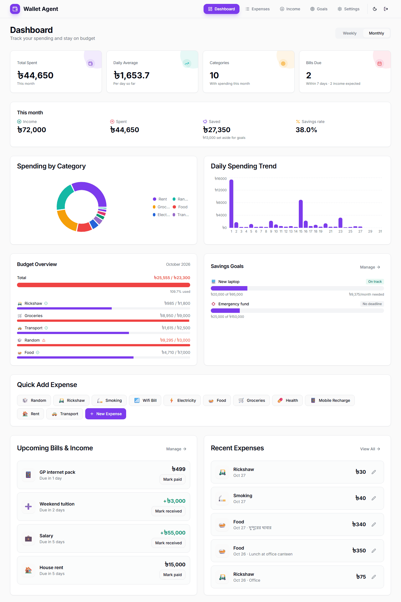
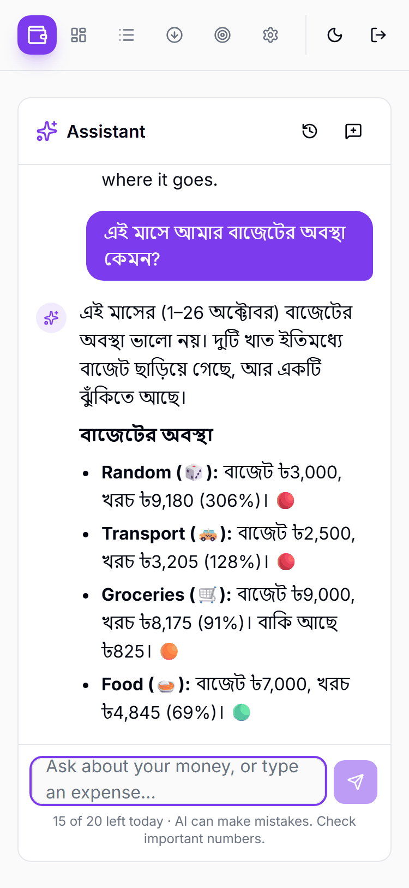
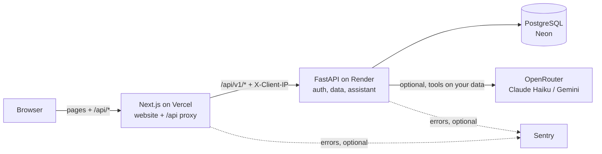

# Wallet Agent

[](https://github.com/mahamudul-hasan-cse/Expense-tracker/actions/workflows/ci.yml?query=branch%3Amain)
[](LICENSE)

An expense tracker for Bangladesh, in Taka. Track spending and income, set monthly budgets and savings goals, get bill reminders, and ask an optional AI assistant about your money in English or বাংলা.

**Live:** https://expense-tracker-orcin-pi.vercel.app

<p align="center">
  
  
</p>

## Features
- **Expenses:** quick add from your most-used categories, search, filters by category and date, and CSV export.
- **Income and savings rate:** money in, money spent and what you saved each month.
- **Monthly budgets:** a limit per category. Bars turn amber at 80% and red when you go over.
- **Savings goals:** set money aside for a laptop or a trip and see how much to save each month to make the deadline.
- **Recurring bills and income:** reminders for the next 7 days, marked paid or received with one tap.
- **AI assistant (optional, off by default):**
  - Ask in English, বাংলা or Banglish ("ei mash e koto khoroch holo?").
  - Answers use your own data, with real numbers.
  - Type "rickshaw 80" to log an expense; nothing is saved until you confirm.
  - Runs on Claude Haiku through OpenRouter, using only providers that keep no data.
- **Works on phones:** a bottom tab bar, layouts tested at 375px, dark mode, and installable as an app (PWA).
- **Accessible:** every page is checked against WCAG 2.1 AA (axe-core) in light and dark mode.

More screenshots are in [`docs/screenshots`](docs/screenshots).

## Tech stack
| | |
|---|---|
| Website | Next.js 15 (App Router), React 19, TypeScript, Tailwind CSS, shadcn/ui, TanStack Query, Recharts |
| API | FastAPI, SQLAlchemy 2.1, Alembic, Pydantic 2, Python 3.11+ (uv) |
| Database | PostgreSQL 16 |
| AI | OpenRouter (Claude Haiku 5.5, Gemini 3.5 Flash Lite as fallback), tool calling, server-sent events |
| Quality | pytest (96% coverage), Vitest, Playwright (e2e, layout, accessibility), ruff, mypy, ESLint, Prettier, pre-commit + gitleaks, GitHub Actions, Dependabot |
| Ops | Docker, Vercel (website), Render (API), Neon (database), Sentry (optional), UptimeRobot |

## Architecture

- The browser only talks to the website. Vercel forwards `/api/*` to the API, so the login cookie stays on the website's own domain (HttpOnly, Secure, SameSite=Strict).
- **Sign-in:** 15-minute access tokens plus a rotating refresh cookie. Every record belongs to one user, with isolation tests on every endpoint.
- **"Today"** is the Asia/Dhaka date everywhere.
- **The assistant** reads your data through read-only tools that always act as the signed-in user. Its daily limits are 50 messages per user and a global dollar budget.

## Run it locally

### Everything in Docker (quickest)
```bash
docker compose --profile full up --build
```
Then open http://localhost:3000. The API is at http://localhost:8000/docs.

### For development
You need Python 3.11+ with [uv](https://docs.astral.sh/uv/), Node 22, and Docker (for Postgres).
```bash
docker compose up -d                          # Postgres on localhost:5432

cd backend
cp .env.example .env
uv sync
uv run alembic upgrade head
uv run python -m scripts.seed_demo --reset    # optional demo data: demo@example.com / demo-password-123
uv run uvicorn app.main:app --reload --port 8000

cd ../frontend                                # second terminal
cp .env.example .env.local
npm install
npm run dev                                   # http://localhost:3000
```
To try the assistant locally, put an OpenRouter key in `backend/.env` (`OPENROUTER_API_KEY`), then turn the assistant on in Settings.

## Configuration
Everything is in [`backend/.env.example`](backend/.env.example) and [`frontend/.env.example`](frontend/.env.example), with comments. The main settings:

**API (`backend/.env`)**
| Variable | Default | What it does |
|---|---|---|
| `APP_ENV` | `development` | `production` turns on strict checks (secure cookies, a real secret key, explicit origins) |
| `DATABASE_URL` | local Postgres | Postgres connection string |
| `SECRET_KEY` | dev value | Signs login tokens. **Required in production** (32+ characters) |
| `ALLOWED_ORIGINS` | `http://localhost:3000` | The website's address(es), comma-separated |
| `APP_TIMEZONE` | `Asia/Dhaka` | What "today" means |
| `PROXY_SHARED_SECRET` | empty | Shared with the website so rate limits see real visitor IPs |
| `OPENROUTER_API_KEY` | empty | Turns the AI assistant on (it's off without a key) |
| `ASSISTANT_MODEL` / `ASSISTANT_FALLBACK_MODELS` | Haiku 5.5 / Gemini 3.5 Flash Lite | Models, chosen by the eval in [`docs/ASSISTANT_EVAL.md`](docs/ASSISTANT_EVAL.md) |
| `ASSISTANT_DAILY_MESSAGE_LIMIT` | `50` | Assistant messages per user per day |
| `ASSISTANT_GLOBAL_DAILY_BUDGET_USD` | `1` | The assistant pauses for everyone once a day's spend reaches this |
| `SENTRY_DSN` | empty | Error monitoring (off without it) |
| `RATE_LIMIT_DEFAULT` | `120/minute` | Requests per IP |

**Website (`frontend/.env.local`, or Vercel's settings)**
| Variable | When it's read | What it does |
|---|---|---|
| `BACKEND_URL` | build time | Where `/api/*` is forwarded (the API's address) |
| `PROXY_SHARED_SECRET` | runtime | Same value as on the API |
| `NEXT_PUBLIC_SENTRY_DSN` / `SENTRY_DSN` | build / runtime | Error monitoring for the browser / server (off without them) |

Never set `NEXT_PUBLIC_API_URL` in production: it would bypass the proxy and break the login cookie.

## Tests
| Suite | Command |
|---|---|
| API (pytest, coverage gate 80%) | `cd backend && uv run pytest` |
| Website unit (Vitest) | `cd frontend && npm test` |
| End-to-end, layout and accessibility (Playwright) | `cd frontend && npm run test:e2e` |
| Lint, format, types | `uv run ruff check . && uv run mypy` · `npm run lint && npm run typecheck` |

CI runs all of them on every push and pull request, and also builds the Docker images and starts the full stack. No test ever calls a real AI model. Details: [`docs/TESTING.md`](docs/TESTING.md).

## Deploying
[`docs/DEPLOYMENT.md`](docs/DEPLOYMENT.md) is a click-by-click guide: the database on Neon, the API on Render (both in Singapore, free to start) and the website on Vercel. Monitoring setup: [`docs/MONITORING.md`](docs/MONITORING.md).

## Documentation
- [API overview and routes](docs/API.md) (full schema at `/docs` on the running API)
- [Deployment](docs/DEPLOYMENT.md) · [Monitoring](docs/MONITORING.md) · [Testing](docs/TESTING.md)
- [Assistant design](docs/ASSISTANT_DESIGN.md) · [Assistant evaluation and model choice](docs/ASSISTANT_EVAL.md) · [Example conversations](docs/ASSISTANT_EXAMPLES.md)
- [Production plan and history](docs/PRODUCTION_PLAN.md) · [UI review](docs/IMPROVEMENTS.md) · [Changelog](CHANGELOG.md)

## Project structure
```
.
├── backend/                 FastAPI app
│   ├── app/
│   │   ├── routers/         HTTP endpoints (auth, expenses, income, goals, ...)
│   │   ├── assistant/       AI assistant: LLM client, tools, chat service, prompt
│   │   ├── models/          SQLAlchemy models
│   │   ├── schemas/         Pydantic request/response models
│   │   └── services/        Shared logic (cashflow, goals, users)
│   ├── alembic/versions/    Database migrations
│   ├── scripts/             Demo data, assistant eval and latency tools
│   ├── tests/               pytest suite
│   └── Dockerfile
├── frontend/                Next.js app
│   ├── src/app/             Pages (App Router)
│   ├── src/components/      UI, by feature
│   ├── src/lib/             API client, queries, formatting, validation
│   ├── e2e/                 Playwright tests (incl. layout and accessibility)
│   └── Dockerfile
├── docs/                    Guides and screenshots
├── docker-compose.yml       Postgres, or the full stack with --profile full
└── render.yaml              Render Blueprint for the API
```

## Contributing
See [CONTRIBUTING.md](CONTRIBUTING.md). Please report security problems privately (details there).

## License
[MIT](LICENSE) © 2026 Mahamudul Hasan
